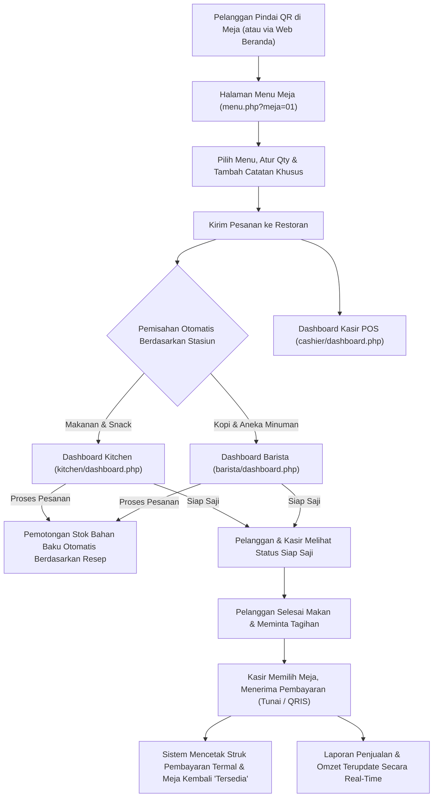

# JAZUVA – Restaurant & Coffee Shop Management System

Sistem Manajemen Restoran dan Coffee Shop berbasis Web Native (PHP, MySQL, HTML5, CSS3, JavaScript) yang dirancang khusus untuk operasional restoran modern dengan pemesanan mandiri melalui QR Code meja, Kitchen & Barista Display System (KDS), Kasir POS dengan cetak struk termal, serta manajemen resep dan pengurangan stok otomatis.

---

## ☕ Identitas & Branding
- **Nama Aplikasi**: JAZUVA
- **Subjudul**: Restaurant & Coffee Shop
- **Slogan**: *Good Food. Good Coffee. Good Mood.*
- **Palet Warna**:
  - Deep Roast Brown (`#331B11` / `#2F1A10`)
  - Warm Caramel Bronze (`#8B5A2B` / `#C69255`)
  - Almond Cream Background (`#FBF8F4` / `#F8F3EC`)
  - Status Indicators: Aman/Tersedia/Siap (Hijau `#27AE60`), Menunggu/Terisi/Menipis (Oranye `#E67E22`), Kritis/Habis/Batal (Merah `#E74C3C`), Diproses (Biru `#2980B9`).

---

## 🔐 Akun & Hak Akses Pengguna (Default Logins)
Semua akun default menggunakan password: `admin123`

| Role | Username | Password | Deskripsi Akses |
| :--- | :--- | :--- | :--- |
| **Administrator** | `admin` | `admin123` | Akses penuh ke seluruh fitur: dashboard analytics, manajemen meja & QR, manajemen menu, kasir POS, kitchen, barista, stok & resep, laporan, dan pengaturan pengguna. |
| **Kasir (POS)** | `kasir` | `admin123` | Dashboard Kasir POS, filter pesanan meja, rincian tagihan, pembayaran tunai & kembalian, QRIS dinamis Midtrans, cetak struk termal, riwayat transaksi. |
| **Kitchen (Dapur)** | `kitchen` | `admin123` | Kitchen Display System (KDS) khusus makanan & snack, antrean kartu pesanan, timer waktu tunggu, update status (Menunggu -> Diproses -> Siap Saji -> Selesai), audio chime notifikasi. |
| **Barista** | `barista` | `admin123` | Barista Display System khusus kopi & minuman, antrean minuman, timer waktu tunggu, update status, pemotongan stok biji kopi/susu otomatis, audio chime notifikasi. |
| **Inventory** | `inventory` | `admin123` | Manajemen stok bahan baku, alert stok menipis/kritis, pencatatan stok masuk (restock), resep menu & takaran per porsi, riwayat audit mutasi stok. |

---

## 🗄️ Database: `jazuva_db`
Database terintegrasi penuh menggunakan MySQL dengan tabel-tabel utama:
1. `roles`: Master data role pengguna (admin, cashier, kitchen, barista, inventory).
2. `users`: Akun pengguna dengan password bcrypt (`password_hash`).
3. `categories`: Kategori menu (makanan, minuman, dessert, snack) dengan routing target stasiun (`kitchen` vs `barista`).
4. `menus`: Katalog menu dengan harga jual, harga modal, gambar, status ketersediaan, dan status favorit.
5. `restaurant_tables`: Data meja restoran (nomor meja, kapasitas kursi, status: tersedia/terisi/dipesan/menunggu_pembayaran, token QR).
6. `table_sessions`: Sesi makan pelanggan di meja tertentu.
7. `orders`: Master pesanan pelanggan (nomor pesanan `ORD-YYYYMMDD-XXX`, status, total tagihan).
   - Kolom `request_token` mencegah pengiriman ulang akibat klik ganda atau percobaan ulang jaringan.
8. `order_items`: Rincian item pesanan per stasiun (`kitchen` vs `barista`), catatan khusus tamu, status pengerjaan, dan flag pemotongan stok (`stock_deducted`).
9. `payments`: Catatan transaksi pembayaran kasir (`TRX-YYYYMMDD-XXX`, metode tunai/QRIS, uang diterima, kembalian, waktu lunas).
10. `ingredients`: Stok bahan baku (nama, kategori, stok aktual, satuan, batas minimum, harga per unit).
11. `recipes`: Master resep hidangan yang terhubung ke menu.
12. `recipe_details`: Takaran bahan per porsi (contoh: Nasi Goreng butuh 0.15 kg beras, 1 butir telur, 0.02 liter minyak).
13. `stock_movements`: Log audit mutasi persediaan (pesanan, masuk, pembatalan, penyesuaian).
14. `settings`: Pengaturan nama restoran, alamat, kontak, pajak PB1, dan service charge.

---

## ⚙️ Alur Kerja Sistem (End-to-End Workflow)

Pemesanan QR memakai token meja, sehingga URL `menu.php?meja=...` tanpa token valid akan ditolak. QRIS POS memakai QR dinamis Midtrans Core API; server memverifikasi status dan nominal transaksi sebelum menutup sesi meja. Jangan mengonfirmasi pembayaran hanya berdasarkan tampilan QR atau bukti dari pelanggan.

Admin dapat menutup menu sementara dari halaman Manajemen Menu tanpa menghapus item atau riwayat transaksi. Menu yang ditutup tetap terlihat berstatus habis pada halaman QR pelanggan, tidak dapat ditambahkan ke keranjang, dan dapat dibuka kembali oleh admin. Kartu menu pilihan di beranda menempatkan nama dan harga di tengah, sejajar dengan gambar produk.

Saat kasir menghitung tagihan, service charge dihitung dari subtotal, lalu PB1 dihitung dari subtotal ditambah service charge. Rincian subtotal, kedua biaya, dan total disimpan pada transaksi agar struk lama tetap akurat meskipun tarif pengaturan berubah.

---

## 🚀 Cara Menjalankan di XAMPP

1. **Jalankan XAMPP Control Panel**:
   - Aktifkan modul **Apache** dan **MySQL**.
2. **Database**:
   - Atur `DB_HOST`, `DB_PORT`, `DB_NAME`, `DB_USER`, dan `DB_PASS` pada environment PHP bila konfigurasi bawaan XAMPP berbeda.
   - Pastikan MySQL berstatus **Running** di XAMPP Control Panel sebelum membuka website. Jika service berhenti, aplikasi memberikan halaman status HTTP 503 yang aman; penyebab teknis dicatat pada PHP error log, tanpa menampilkan stack trace kepada pengunjung.
   - Jalankan `C:\xampp\php\php.exe setup.php` dari folder proyek. `setup.php` membuat database/tabel yang belum ada dan hanya memasukkan seed saat database benar-benar kosong; script tidak menghapus data.
   - Setup membuat `config/.setup.lock` setelah berhasil. Setup lewat web ditolak kecuali memakai token sementara `JAZUVA_SETUP_TOKEN` melalui POST. Jangan menghapus lock untuk database aktif tanpa backup.
   - `config/database.sql` adalah skema non-destruktif. `database/jazuva_db.sql` tetap disediakan sebagai dump awal/rujukan historis, bukan untuk diimpor ulang ke database yang berisi data.
   - Jika database lama tidak memiliki kolom dari migrasi historis, cadangkan dahulu dan jalankan skrip migrasi terkait satu kali setelah memeriksa skema: `database/migrate_request_token.sql`, migrasi presisi stok, rincian pembayaran, dan `database/migrate_midtrans_qris.sql`.
3. **Akses Aplikasi**:
   - Website dapat diakses melalui:
     - `http://localhost/jazuva/`
     - atau `http://localhost/Project PWD Kelompok 7/`
4. **Halaman Utama**:
   - Beranda: `http://localhost/jazuva/index.php`
   - Login: `http://localhost/jazuva/login.php`
   - Pemesanan pelanggan: pindai QR resmi di meja atau pilih meja pada halaman landing/scan. QR menyertakan token unik meja.
   - Scanner Kamera QR: `http://localhost/jazuva/scan.php`
   - Dashboard Admin: `http://localhost/jazuva/admin/dashboard.php`
   - Denah Meja & QR: `http://localhost/jazuva/admin/tables.php`
   - Kasir POS: `http://localhost/jazuva/cashier/dashboard.php`
   - Kitchen Display: `http://localhost/jazuva/kitchen/dashboard.php`
   - Barista Display: `http://localhost/jazuva/barista/dashboard.php`
   - Stok Bahan Baku: `http://localhost/jazuva/inventory/dashboard.php`
   - Laporan & Keuangan: `http://localhost/jazuva/admin/reports.php`

### Konfigurasi Midtrans QRIS (Sandbox)

1. Dapatkan **Server Key Sandbox** dari dashboard merchant Midtrans. Jangan gunakan Client Key sebagai Server Key.
2. Sediakan `MIDTRANS_SERVER_KEY` sebagai environment variable untuk proses Apache/PHP dan set `MIDTRANS_IS_PRODUCTION=false`. Pada XAMPP, keduanya dapat diatur di konfigurasi Apache lokal (misalnya `C:\xampp\apache\conf\extra\httpd-xampp.conf` menggunakan `SetEnv`) atau environment Windows; jangan masukkan key ke file proyek, SQL, JavaScript, atau Git.
3. Restart Apache setelah mengubah environment. Pastikan migrasi kolom QRIS telah diterapkan pada database.
4. Buat transaksi QRIS dari POS. Status diperiksa server-ke-server melalui Midtrans; pembayaran hanya dianggap lunas setelah status `settlement` dan nominal cocok. Pastikan halaman POS tetap dibuka untuk polling pada pengujian lokal.
5. Untuk produksi, atur `MIDTRANS_IS_PRODUCTION=true` dan gunakan Server Key Production. Gunakan konfigurasi live hanya setelah merchant aktif dan lakukan pengujian sesuai prosedur operasional.

Jika permintaan gateway timeout, jangan membuat transaksi pembayaran pengganti secara manual. POS akan mencoba memulihkan transaksi yang masih menunggu melalui status Midtrans; timeout tidak otomatis membatalkan transaksi karena gateway mungkin sudah menerimanya. Penolakan HTTP yang definitif dari Midtrans ditandai batal, sehingga kasir dapat mencoba membuat QR baru.

## Struktur MVC dan rute

Core MVC tersedia di `app/Core`, controller ada di `app/Controllers`, dan lapisan data PDO prepared statement ada di `app/Models`. Rute ekstensi-less seperti `/admin/tables`, `/kitchen`, `/cashier`, serta `/inventory/recipes` masuk melalui `index.php`; file `.php` lama tetap dipertahankan sebagai adapter kompatibilitas agar tautan prototype dan QR meja (`menu.php?meja=...&token=...`) tidak berubah. Model mengarsipkan meja/menu dan menolak penghapusan riwayat order, pembayaran, serta mutasi stok.

Frontend bersama dimuat dari `assets/css/style.css`, `assets/css/responsive.css`, dan `assets/js`. `assets/css/dashboard.css`, `assets/css/pos.css`, dan stylesheet customer tetap digunakan karena mengandung gaya khusus prototipe.
